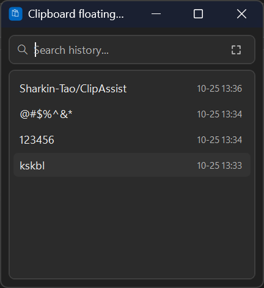

# ClipAssist

**English** | [简体中文](README.zh-CN.md)

ClipAssist is a lightweight clipboard history utility for Windows 11, built with C#, WPF, and .NET. It is designed to make accessing, searching, and managing clipboard history more convenient.

## Project Status

ClipAssist is under active development. Features and behavior may change as the project evolves.

## Screenshots

**This is Floating Window Mode**

## Features

- **Clipboard History** — Keep track of recently copied text.
- **Search** — Quickly find entries in clipboard history.
- **Search Highlighting** — Highlight matching text in search results.
- **History Management** — Delete individual entries and manage clipboard history.
- **Floating Window** — Access clipboard history through a compact floating interface.
- **Drag-to-Copy** — Manually drag text from the floating window to compatible external applications to copy or transfer it.
- **Global Keyboard Shortcuts** — Access clipboard features using keyboard shortcuts.

## Download

Visit the [GitHub Releases](../../releases) page to find available downloads.

Available packages may include a portable version and a Windows installer, depending on the release.

## Installation

### Installer Version

1. Download the Windows installer from the [Releases](../../releases) page.
2. Run the installer.
3. Follow the on-screen instructions to complete installation.
4. Launch ClipAssist.

### Portable Version

1. Download the portable ZIP package from the [Releases](../../releases) page.
2. Extract the archive to a folder of your choice.
3. Run the application executable.

## System Requirements

- **Operating System:** Windows 11, 64-bit.
- **Runtime:** Requirements depend on the .NET deployment configuration of the downloaded release.

## Privacy

ClipAssist is designed as a personal desktop utility. For information about data handling and privacy, see [PRIVACY.md](PRIVACY.md).

## Technology Stack

- **Language:** C#
- **UI Framework:** Windows Presentation Foundation (WPF)
- **Platform:** .NET
- **Target Environment:** Windows 11 x64

## Roadmap

ClipAssist is being developed iteratively. Future improvements may focus on usability, stability, performance, and compatibility.

## Bug Reports and Feedback

If you encounter a bug or have a suggestion, please submit an issue through the [GitHub Issues](../../issues) page.

When reporting a bug, include the steps to reproduce it, the expected behavior, and the actual behavior whenever possible.

## License

See the [LICENSE](LICENSE) file for the applicable license terms. All rights are reserved unless explicitly stated otherwise.

## Acknowledgments

Thanks to everyone who provides feedback and helps improve ClipAssist.
