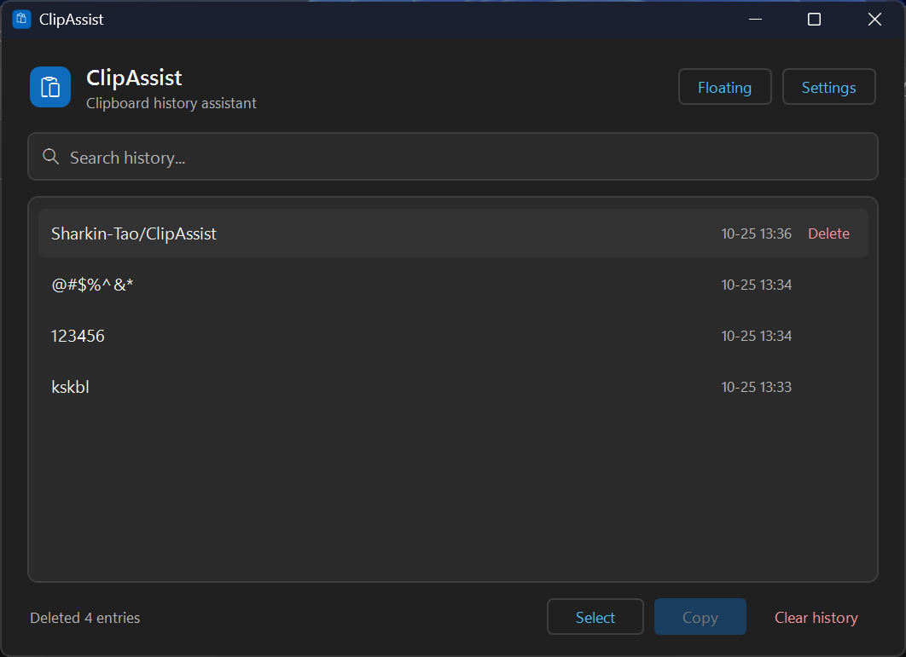
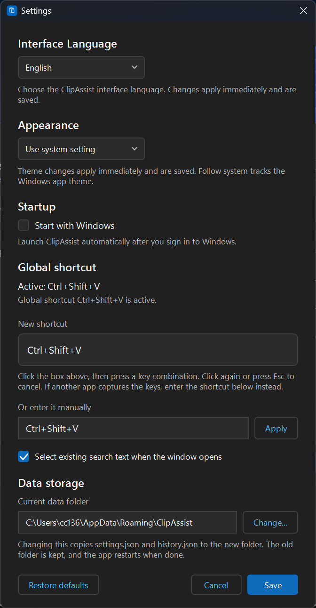

# ClipAssist

[English](README.md) | **简体中文**

ClipAssist 是一款面向 Windows 11 的轻量级剪贴板历史管理工具，使用 C#、WPF 和 .NET 开发，旨在让剪贴板历史的查看、搜索和管理更加方便。

## 项目状态

ClipAssist 目前正在积极开发中。随着项目不断完善，功能和使用方式可能会发生变化。

## 截屏

## 功能特性

- **剪贴板历史记录** — 记录近期复制的文本内容。
- **搜索** — 快速查找剪贴板历史记录。
- **搜索结果高亮** — 高亮显示搜索结果中的匹配文本。
- **历史记录管理** — 删除单条记录并管理剪贴板历史。
- **浮窗模式** — 通过紧凑的浮动界面访问剪贴板历史。
- **拖动复制** — 在浮窗模式下，手动将文本拖动到兼容的外部应用程序中，实现文本复制或传递。
- **全局快捷键** — 通过键盘快捷键访问剪贴板相关功能。

## 下载

前往 [GitHub Releases 发布页面](../../releases) 查看可用的下载版本。

根据不同的发布版本，可能提供便携版压缩包和 Windows 安装程序。

## 安装说明

### 安装版

1. 从 [Releases 发布页面](../../releases) 下载 Windows 安装程序。
2. 运行安装程序。
3. 按照屏幕提示完成安装。
4. 启动 ClipAssist。

### 便携版

1. 从 [Releases 发布页面](../../releases) 下载便携版 ZIP 压缩包。
2. 将压缩包解压到任意文件夹。
3. 运行应用程序的可执行文件。

## 系统要求

- **操作系统：** Windows 11，64 位。
- **运行环境：** 具体要求取决于所下载版本采用的 .NET 部署配置。

## 隐私说明

ClipAssist 定位为个人桌面工具。有关数据处理和隐私的说明，请参阅 [PRIVACY.md](PRIVACY.md)。

## 技术栈

- **开发语言：** C#
- **用户界面框架：** Windows Presentation Foundation（WPF）
- **运行平台：** .NET
- **目标环境：** Windows 11 x64

## 开发计划

ClipAssist 将采用迭代方式持续开发。后续改进可能侧重于易用性、稳定性、性能和兼容性。

## 问题反馈

如果你在使用过程中遇到问题，或有功能改进建议，可以通过 [GitHub Issues](../../issues) 提交反馈。

提交问题时，建议尽可能提供复现步骤、预期行为和实际行为，以便定位问题。

## 许可证

具体使用条款请参阅 [LICENSE](LICENSE) 文件。除非另有明确说明，本项目保留所有权利。

## 致谢

感谢所有为 ClipAssist 提供反馈和改进建议的人。
